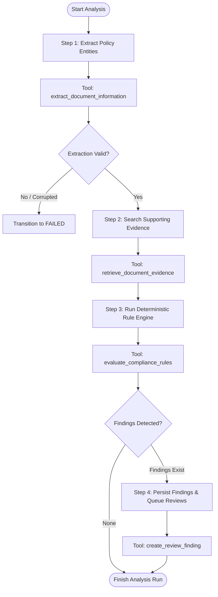

# AGENTRA — Agent Architecture & Orchestrator Design

**Document Version:** 1.0.0  
**Status:** Approved for Review  
**Date:** 2026-11-12  

---

## 1. Agent Design Philosophy

Agentra implements **Controlled Agent Orchestration**. 

Unlike unpredictable autonomous multi-agent swarms or open-ended chat loops, Agentra's agent operates under a deterministic state machine with strict execution boundaries:
1. **Bounded Step Count:** Maximum 6 execution steps per run. Infinite loops are mathematically impossible.
2. **Explicit Tool Allowlist:** The agent can only execute 4 pre-registered, strictly typed Python tools.
3. **No Direct Execution by LLM:** The LLM does not execute code; it requests a tool invocation. The backend validates the request, inspects authorization, runs the tool in a sandbox, and passes observations back.
4. **State Snapshotting:** Every step transition, input argument, observation, and duration is recorded in PostgreSQL (`analysis_steps`).

---

## 2. Agent State Model (`AgentState`)

```python
from pydantic import BaseModel, Field
from typing import Dict, Any, List, Optional
from uuid import UUID

class AgentState(BaseModel):
    analysis_run_id: UUID
    document_id: UUID
    requested_by: UUID
    current_step: int = 0
    max_steps: int = 6
    execution_status: str = "INITIALIZED"  # INITIALIZED, RUNNING, COMPLETED, FAILED
    
    # Ingested & Extracted Entities
    raw_text: Optional[str] = None
    extraction_result: Optional[Dict[str, Any]] = None
    retrieved_evidence: List[Dict[str, Any]] = Field(default_factory=list)
    
    # Rule Evaluation Results
    rule_results: List[Dict[str, Any]] = Field(default_factory=list)
    generated_findings: List[Dict[str, Any]] = Field(default_factory=list)
    
    # Telemetry & History
    step_history: List[Dict[str, Any]] = Field(default_factory=list)
    errors: List[str] = Field(default_factory=list)
```

---

## 3. Orchestration Workflow



---

## 4. Execution Circuit Breaker & Limits

1. **Step Limit:** If `current_step > max_steps` (6 steps), the orchestrator immediately halts execution, sets status to `FAILED`, and logs `STEP_LIMIT_EXCEEDED`.
2. **Tool Timeout:** Each individual tool invocation has a hard timeout of 15 seconds.
3. **Run Timeout:** Total analysis run duration cannot exceed 60 seconds.
4. **No Side-Channel Network Calls:** Tools cannot make outbound network requests, except the Gemini client which accesses the Google Gen AI API via validated endpoints.
