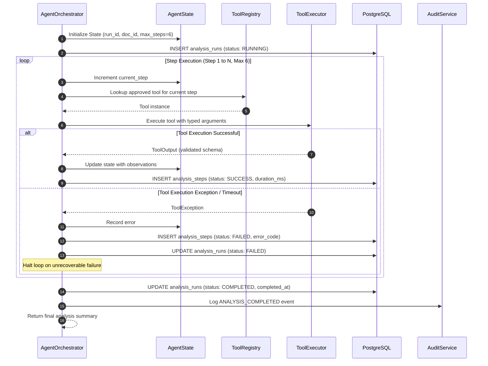

# AGENTRA — Agent Execution Flow & State Transitions

**Document Version:** 1.0.0  
**Status:** Approved for Review  
**Date:** 2026-11-12  

---

## 1. Step-by-Step Sequence Flow

---

## 2. Agent State Transition Matrix

| Initial State | Event / Action | Next State | Condition |
| :--- | :--- | :--- | :--- |
| `INITIALIZED` | Orchestrator starts run | `RUNNING` | Document status is `READY_FOR_ANALYSIS` |
| `RUNNING` | Step count exceeds 6 | `FAILED` | Circuit breaker tripped (`STEP_LIMIT_EXCEEDED`) |
| `RUNNING` | Uncaught tool error / Gemini timeout | `FAILED` | Unrecoverable error in tool execution |
| `RUNNING` | All rules evaluated & findings recorded | `COMPLETED` | Normal completion of 4-step pipeline |
| `FAILED` | Post-mortem inspection | `ARCHIVED` | Preserved for engineering analysis |

---

## 3. Tool Sandboxing & Argument Sanitization

Before executing any tool, the `ToolExecutor`:
1. Sanitizes string inputs to prevent SQL injection or path traversal attempts.
2. Validates types using Pydantic (`ValidationError` is caught and converted to an `INVALID_TOOL_ARGUMENT` step failure).
3. Strips sensitive tokens (such as user passwords or API keys) from input/output metadata before storing in `analysis_steps`.
