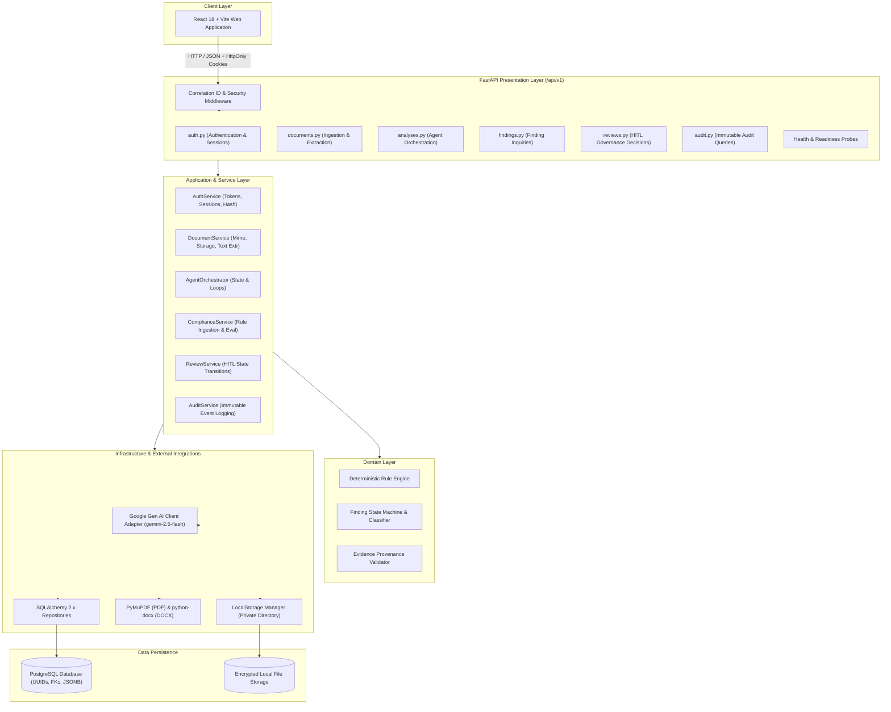
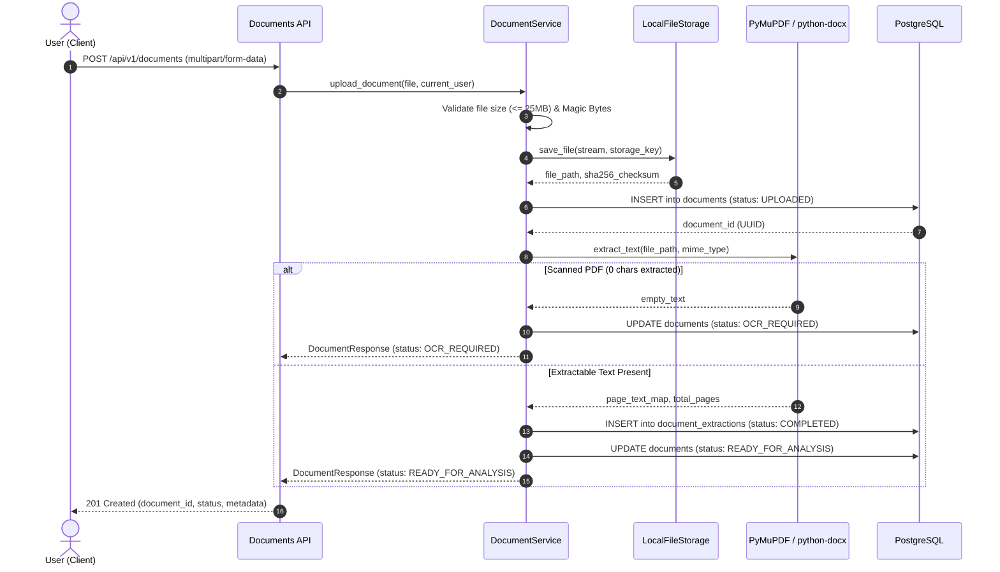
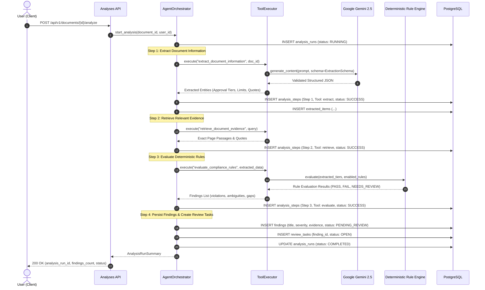
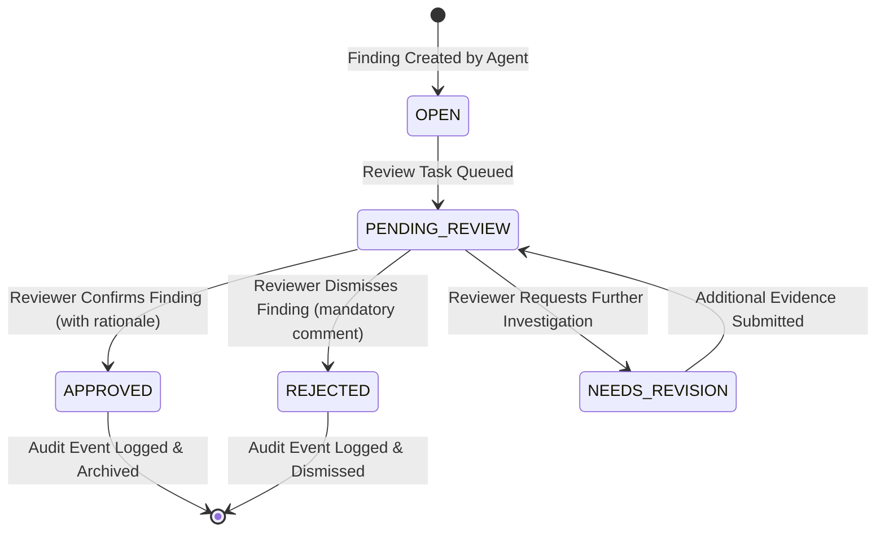

# AGENTRA — System Architecture & Engineering Specification

**Document Version:** 1.0.0  
**Status:** Approved for Review  
**Date:** 2026-11-12  
**Target:** Modular Monolith with Layered Clean Architecture  

---

## 1. Architecture Overview

Agentra is structured as a **Modular Monolith** engineered for high developer velocity, clear conceptual boundaries, strict transaction isolation, and uncompromising audibility. 

Rather than prematurely distributing business logic across microservices, the backend runs as a single, highly structured FastAPI process subdivided into distinct domain modules. Each module enforces strict layer separation:
1. **API / Presentation Layer:** Handles HTTP routing, input validation (Pydantic schemas), auth dependency injection, and uniform JSON serialization.
2. **Application / Service Layer:** Coordinates business workflows, use-case transactions, authorization enforcement, and orchestrates domain logic.
3. **Domain Layer:** Pure business entities, status state machines, deterministic compliance rule evaluators, and validation rules free of framework dependencies.
4. **Infrastructure Layer:** Concrete implementations of database persistence (SQLAlchemy 2.x repositories), file system storage, and the Gemini AI client.



---

## 2. Component Responsibility Matrix

| Component | Layer | Primary Responsibility | Direct Dependencies |
| :--- | :--- | :--- | :--- |
| `API Routers` | Presentation | Validate HTTP input, extract JWT, call Service methods, format standard response | Services, Pydantic Schemas, Dependencies |
| `AuthService` | Application | Argon2id verification, JWT minting, refresh token rotation, session revocation | User Repo, Session Repo, Security utils |
| `DocumentService` | Application | Magic byte checks, file storage coordination, text extraction dispatch | Doc Repo, Extraction Repo, FileStore, Parsers |
| `AgentOrchestrator`| Application | Step-by-step agent loop, tool dispatch, state transitions, step logging | Tool Registry, Analysis Repo, Step Repo, Gemini |
| `ToolRegistry` | Application | Registry of 4 approved tools, argument validation, and invocation isolation | Service tools, Domain logic |
| `ComplianceEngine` | Domain | Mathematical & structural rule evaluation with allowlisted operators | Compliance Rules, Extracted Entities |
| `ReviewService` | Application | HITL decisions, reviewer authorization, atomic finding updates | Finding Repo, Review Task Repo, Audit Repo |
| `GeminiClient` | Infrastructure| Google Gen AI SDK wrapper, structured prompt rendering, retry logic | Google Gen AI SDK, Settings |
| `FileStorage` | Infrastructure| Private disk write/delete, SHA-256 calculation, path traversal guard | File system, Settings |
| `AuditService` | Infrastructure| Structured audit event creation with correlation ID | Audit Event Repo, Request Context |

---

## 3. Dependency Rules & Architecture Boundaries

1. **Inward-Facing Dependencies:** API routes depend on Services. Services depend on Repositories and Domain logic. Repositories depend on SQLAlchemy models.
2. **No Direct Route Queries:** API routes must NEVER execute direct SQL or SQLAlchemy session queries; all queries pass through typed repositories.
3. **No External Calls in Domain:** The `RuleEngine` is pure Python. It never calls the database, HTTP endpoints, or Gemini.
4. **No LLM in Transaction:** External network calls to Gemini must NEVER occur while holding an active PostgreSQL transaction lock. Transactions are opened to save status, closed during LLM inference, and opened again to record outputs.
5. **No Circular Imports:** Dependency injection via FastAPI `Depends()` enforces clean unidirectional graphs.

---

## 4. End-to-End Lifecycles

### 4.1 Document Ingestion & Processing Lifecycle



---

### 4.2 AI Agent Orchestration & Compliance Lifecycle



---

### 4.3 Human-in-the-Loop Review Lifecycle



---

## 5. Security & Isolation Boundaries

1. **User Identity Boundary:** Verified via Argon2id hash at login; signed JWT access token in authorization header (`Bearer <token>`).
2. **Session Persistence Boundary:** Rotating refresh token stored in an `HttpOnly`, `Secure`, `SameSite=Lax` cookie. Browser JavaScript cannot access or tamper with refresh tokens.
3. **Data Access Boundary:** Every repository query filters by `owner_id == current_user.id`, except for authorized `REVIEWER` roles inspecting assigned reviews.
4. **File System Boundary:** Uploaded documents are stored outside the public directory tree (`storage/documents/<uuid>.dat`). Filenames are strictly UUIDs; path traversal (`../`) is impossible.
5. **AI Safety Boundary:** Document contents are treated as untrusted user inputs wrapped in XML delimiters. System prompts strictly prohibit tool invocation or policy modification via document contents.
6. **Tool Execution Boundary:** The agent cannot execute arbitrary Python, system commands, or SQL. Only 4 pre-registered, strongly typed tools are callable.

---

## 6. Resilience & Failure Handling Strategy

```
+---------------------------+-----------------------------------+------------------------------------------+
|       Failure Mode        |         Detection Point           |           Mitigation / Recovery          |
+---------------------------+-----------------------------------+------------------------------------------+
| Network Timeout (Gemini)  | GeminiClient HTTP Call            | Exponential backoff retry (3x, 1s/2s/4s) |
| Schema Validation Error   | Pydantic Parse in GeminiParser    | Transition run to FAILED; log raw parse  |
| Database Connection Drop  | SQLAlchemy Session pool checkout  | Auto reconnect; fail request with 503    |
| File Parsing Crash (PDF)  | PyMuPDF Document open             | Catch MuPDF error; mark status CORRUPT   |
| Step Count Overflow       | AgentOrchestrator loop check      | Abort loop at step 6; flag STEP_LIMIT    |
| Invalid State Transition  | ReviewService.decide_review()     | 400 Bad Request; atomic rollback         |
+---------------------------+-----------------------------------+------------------------------------------+
```

---

## 7. Future Extension Points (Post-MVP)
- **OCR Pipeline:** Drop-in integration of Tesseract or Google Cloud Vision for scanned document image OCR.
- **Asynchronous Task Queue:** Transitioning `AgentOrchestrator` execution to Celery/ARQ with Redis for long documents ($\ge 200$ pages).
- **RAG Vector Search:** Adding pgvector extension to PostgreSQL for semantic clause retrieval across thousands of historical policies.
- **Enterprise SSO:** SAML 2.0 and OIDC integrations for Google Workspace and Microsoft 365 identity federation.
