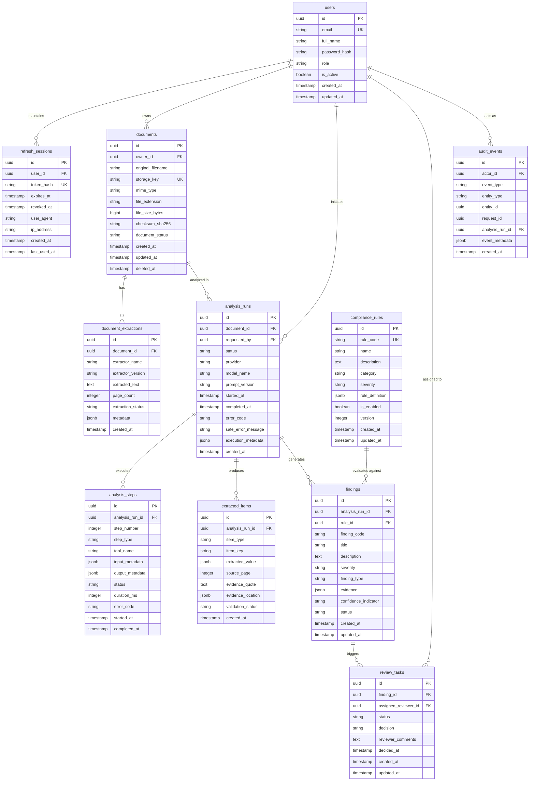

# AGENTRA — Entity Relationship Diagram (ERD)

**Document Version:** 1.0.0  
**Status:** Approved for Review  
**Date:** 2026-11-12  
**Target:** PostgreSQL 15+ Schema Specification  

---

## 1. High-Level Entity Relationship Diagram

---

## 2. Cardinality and Referential Integrity Rules

1. **`users` $\to$ `refresh_sessions` (1:N):**
   - Cascade: `ON DELETE CASCADE`. If a user account is deleted, their active sessions are immediately erased.
2. **`users` $\to$ `documents` (1:N):**
   - Cascade: `ON DELETE RESTRICT`. A user account cannot be deleted if active corporate documents exist (requires explicit document transfer or purge).
3. **`documents` $\to$ `document_extractions` (1:N):**
   - Cascade: `ON DELETE CASCADE`. Removing a document purges its derived raw text cache.
4. **`documents` $\to$ `analysis_runs` (1:N):**
   - Cascade: `ON DELETE RESTRICT`. Preserves governance history even if a document is soft-deleted.
5. **`analysis_runs` $\to$ `analysis_steps` (1:N):**
   - Cascade: `ON DELETE CASCADE`. Execution telemetry belongs solely to its analysis run.
6. **`analysis_runs` $\to$ `extracted_items` (1:N):**
   - Cascade: `ON DELETE CASCADE`. Derived items bound to run lifecycle.
7. **`analysis_runs` $\to$ `findings` (1:N):**
   - Cascade: `ON DELETE RESTRICT`. Findings tied to compliance outcomes cannot be casually dropped.
8. **`compliance_rules` $\to$ `findings` (1:N):**
   - Foreign Key: `ON DELETE SET NULL`. If a historical rule definition is decommissioned, findings retain a snapshot of what was evaluated.
9. **`findings` $\to$ `review_tasks` (1:N):**
   - Cascade: `ON DELETE RESTRICT`. Review decisions are legal records; deleting a finding requires resolution of all review tasks.
10. **`users` $\to$ `audit_events` (1:N):**
    - Foreign Key: `ON DELETE SET NULL`. If an actor is purged, the audit record remains intact with `actor_id = NULL` and metadata preserving historical identity.
