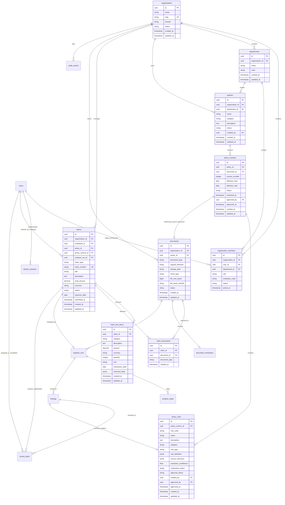
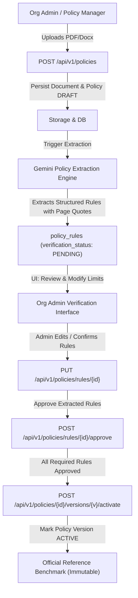
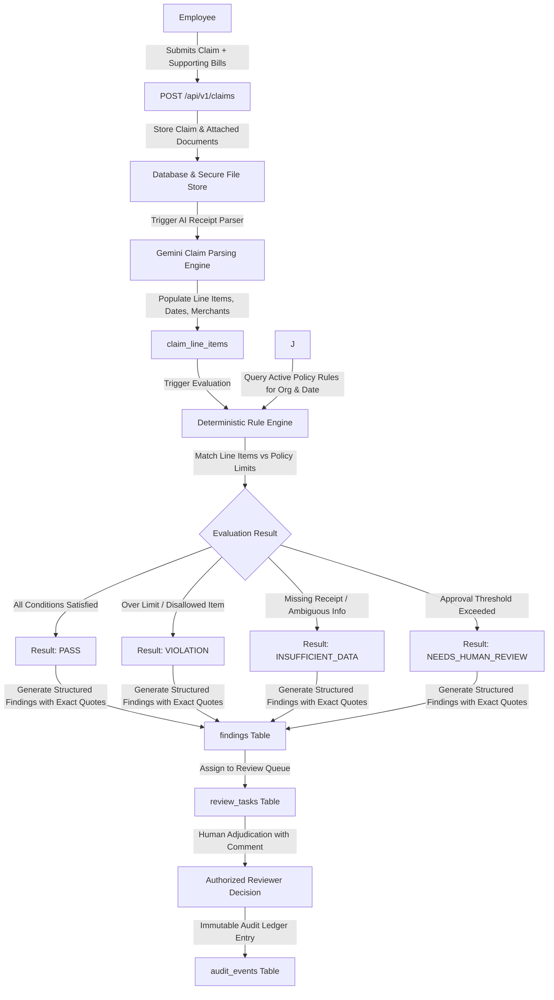

# Agentra AI — Multi-Tenant Enterprise Policy Intelligence Architecture Assessment

**Document Type:** Multi-Tenant Architecture Assessment & Engineering Blueprint  
**Platform:** Agentra AI  
**Version:** 2.0  
**Status:** Pre-Implementation Specification & Design Reference  
**Engineering Standards:** Multi-tenant isolation, deterministic rule execution, verifiable quote provenance, strict auditability, human-in-the-loop review.

---

## 1. Executive Summary & Problem Analysis

Agentra was originally designed as a single-tenant document intelligence MVP where:
1. All documents uploaded by users were treated uniformly under a generic document model.
2. Compliance evaluations were executed against seeded global rules (`DEFAULT_COMPLIANCE_RULES` in Python) rather than customer-specific policies.
3. Analysis runs evaluated a document in isolation (checking if an uploaded document adheres to hardcoded thresholds).

### The Enterprise Reality
In real-world enterprise operations:
- **No two companies share the exact same rules:** Company A allows $150/night for hotel stays; Company B allows $250; Company C caps meals at $75/day while Company D allows itemized meal expenses up to $120 with Director approval.
- **Rules evolve over time:** A travel policy revised on June 1, 2026 must evaluate claims incurred in May against the old policy version, and claims incurred in July against the new policy version.
- **Policies span multiple operational domains:** Beyond expense reimbursements, enterprises enforce policies for Employee Leave, Business Travel authorizations, Procurement requests, HR compliance, and Vendor contracts.
- **Zero-Trust Multi-Tenancy:** Data belonging to Organization Alpha must be strictly isolated from Organization Beta at the database, query, caching, and API layers.
- **Policy as Source of Truth:** Gemini must **never** invent or hallucinate policy limits. An enterprise uploads its official signed policy document, Gemini extracts candidate structured rules with verbatim citations and page numbers, an authorized Company Admin verifies, adjusts, and approves the rules, and a **deterministic Python rule engine** executes those approved rules against employee submissions.

---

## 2. Existing Architecture vs Target Multi-Tenant Architecture

| Architectural Area | Existing MVP Architecture | Target Multi-Tenant Architecture (Agentra 2.0) |
| :--- | :--- | :--- |
| **Tenancy Model** | Single-tenant (flat `User` table, global document namespace). | Logical multi-tenancy with `Organization`, `OrganizationMember`, and `Department` entities. All business objects scoped by `organization_id`. |
| **Document Classification** | Uniform `Document` model without functional categorization. | Strict split: **Company Standard Documents** (`POLICY_DOCUMENT`) vs **Employee Submission Documents** (`EMPLOYEE_CLAIM_DOCUMENT`). |
| **Rule Source of Truth** | Hardcoded/seeded Python constants (`DEFAULT_COMPLIANCE_RULES`). | Dynamic, versioned, admin-approved `PolicyRule` records extracted from uploaded enterprise policy documents. |
| **Policy Versioning** | None. | Immutable `PolicyVersion` records with `effective_from`, `effective_until`, `version_number`, and lifecycle states (`DRAFT`, `PENDING_APPROVAL`, `APPROVED`, `ACTIVE`, `ARCHIVED`). |
| **Claim Processing** | Generic 4-step orchestrator analyzing a single document. | Domain-specific `Claim` and `ClaimLineItem` models linked to supporting receipts/documents, evaluated deterministically against active policy rules. |
| **Rule Engine** | Static evaluator checking flat JSON dictionary against global rules. | Multi-tier deterministic engine evaluating claim line items, totals, receipts, and submission timeliness against active `PolicyRule` criteria. |
| **Human-in-the-Loop** | Single reviewer task per document analysis. | Hierarchical review tasks tied to organizational roles (`ORG_ADMIN`, `POLICY_MANAGER`, `AUDITOR`, `EMPLOYEE`), with mandatory reviewer comments and audit trail. |
| **User Interface** | Single document table and analysis cards. | Enterprise workspace with Organization selector, Policy Management hub, Policy Rule Approver, Employee Claim Submission portal, and Review Queue. |

---

## 3. Comprehensive Entity-Relationship Diagram (ERD)

---

## 4. Multi-Tenant Isolation & Security Strategy

### 4.1 Logical Tenant Partitioning
1. **Foreign Key Enforcement:** Every business table (`documents`, `policies`, `claims`, `analysis_runs`, `findings`, `review_tasks`, `audit_events`) holds a mandatory or indexed `organization_id` foreign key referencing `organizations.id`.
2. **Context-Aware Database Access:** The API layer extracts the authenticated user's active `organization_id` from the JWT claims and/or request header (`X-Organization-Id`).
3. **Repository Scope Guarding:** All database queries in repository services include `filter(Model.organization_id == active_org_id)`. Cross-tenant data leakage is strictly impossible even if an attacker guesses a valid UUID from another organization.
4. **Composite Database Indexes:**
   - `CREATE INDEX idx_policies_org ON policies(organization_id, status);`
   - `CREATE INDEX idx_claims_org_status ON claims(organization_id, status);`
   - `CREATE INDEX idx_documents_org ON documents(organization_id, document_type);`

### 4.2 Role-Based Access Control (RBAC) Matrix

| Role | Policy Management | Rule Approval | Claim Submission | Claim Review & Decision | Audit Logs |
| :--- | :---: | :---: | :---: | :---: | :---: |
| **SYSTEM_ADMIN** | Manage All Orgs | View | View | View | Full Access |
| **ORG_ADMIN** | Full (Create/Edit) | Full Approval | Can Submit | Full Decision | Org Access |
| **POLICY_MANAGER** | Create/Edit Policies | Request Approval | Can Submit | Review Findings | Read-Only |
| **REVIEWER / AUDITOR** | Read Policies | Read Rules | Can Submit | Adjudicate Claims | Full Read-Only |
| **EMPLOYEE** | Read Active Policies | None | Create & View Own | View Own Status | Own History |

---

## 5. End-to-End Workflow Architecture

### 5.1 Policy Ingestion & Rule Verification Workflow

### 5.2 Employee Claim Submission & Deterministic Evaluation Workflow

---

## 6. API Inventory & Contract Roadmap

### 6.1 Organization & Tenant Management
- `POST /api/v1/organizations` — Provision new enterprise organization.
- `GET /api/v1/organizations/current` — Get active organization profile & memberships.
- `GET /api/v1/organizations/members` — List members, roles, and department assignments.
- `POST /api/v1/organizations/members` — Invite or add employee to organization.

### 6.2 Policy Management & Rule Extraction
- `POST /api/v1/policies` — Create policy and upload official policy standard document.
- `GET /api/v1/policies` — List organization policies with status filters.
- `GET /api/v1/policies/{id}` — Retrieve policy details, version history, and rule sets.
- `POST /api/v1/policies/{id}/versions` — Create a new version of an existing policy.
- `POST /api/v1/policies/{id}/versions/{version_id}/extract` — Run Gemini rule extraction on policy document.
- `PUT /api/v1/policies/rules/{rule_id}` — Edit an extracted rule (e.g. adjust limit amount or description).
- `POST /api/v1/policies/rules/{rule_id}/approve` — Approve a verified rule.
- `POST /api/v1/policies/{id}/versions/{version_id}/activate` — Activate the policy version as the organization's official benchmark.

### 6.3 Claim Submission & Compliance Evaluation
- `POST /api/v1/claims` — Submit employee claim (with form metadata and attached receipt/bill documents).
- `GET /api/v1/claims` — List claims (employees view own; reviewers view org-wide queue).
- `GET /api/v1/claims/{id}` — Get claim details, line items, attached receipts, and evaluation findings.
- `POST /api/v1/claims/{id}/evaluate` — Trigger deterministic compliance evaluation against applicable policy version.
- `POST /api/v1/claims/{id}/resubmit` — Employee resubmits updated information/receipts if revision requested.

### 6.4 Review Queue & Human Governance
- `GET /api/v1/reviews` — Review queue with status, risk severity, and claim filters.
- `GET /api/v1/reviews/{id}` — Review task details showing claim evidence, policy citations, and findings.
- `POST /api/v1/reviews/{id}/adjudicate` — Reviewer decision (`APPROVE`, `REJECT`, `REQUEST_REVISION`) with mandatory justification.

---

## 7. Zero-Data-Loss Database Migration Strategy

1. **Non-Destructive Schema Evolution:** Existing tables (`users`, `documents`, `analysis_runs`, `findings`, `review_tasks`, `audit_events`) are retained.
2. **Nullable Foreign Keys During Transition:** New columns like `organization_id` and `document_type` on existing tables are introduced as nullable to preserve existing rows without data loss.
3. **Data Backfill Migration:** A migration script automatically provisions a default organization ("Default Enterprise Workspace") and links existing records to it.
4. **Strict Forward Constraints:** All newly created records require explicit `organization_id` associations.

---

## 8. Verification & QA Matrix

- **Unit Testing:**
  - Rule engine operator evaluation (amounts, dates, categories, booleans).
  - Claim item extraction and parsing.
  - Multi-tenant query isolation and scope enforcement.
- **Integration Testing:**
  - Policy upload $\to$ rule extraction $\to$ admin verification $\to$ policy version activation.
  - Claim submission $\to$ receipt parsing $\to$ deterministic rule evaluation $\to$ finding generation.
  - Reviewer adjudication $\to$ claim status update $\to$ immutable audit ledger recording.
- **Security Testing:**
  - Cross-tenant BOLA/IDOR attempt tests (User from Org A cannot access Policy or Claim from Org B).
  - RBAC privilege escalation tests (Employee cannot approve rules or adjudicate claims).
  - Self-approval prevention tests (Reviewer cannot approve their own claim).

---
*Architectural assessment complete and verified for execution.*
