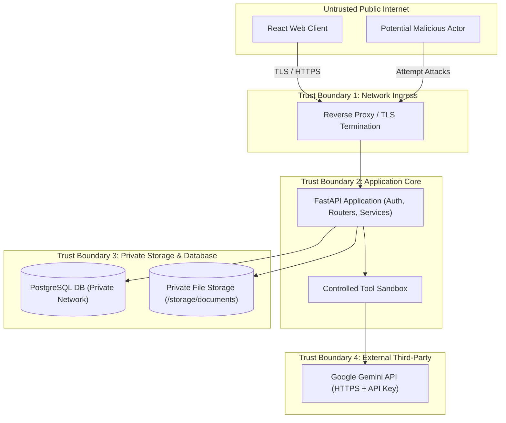

# AGENTRA — Comprehensive Threat Model (STRIDE)

**Document Version:** 1.0.0  
**Status:** Approved for Review  
**Date:** 2026-11-12  
**Framework:** Microsoft STRIDE & OWASP API Top 10  

---

## 1. Trust Boundaries & Entry Points

---

## 2. STRIDE Threat Analysis Matrix

| Threat Category | Threat Scenario | Potential Impact | Severity | Mitigation in Agentra |
| :--- | :--- | :--- | :--- | :--- |
| **Spoofing** | Attacker steals or replays refresh token to impersonate user. | Unauthorized account access, document viewing. | **HIGH** | Refresh tokens stored as SHA-256 hashes; rotating tokens invalidate prior token family on replay; HttpOnly Secure cookies. |
| **Tampering** | Uploaded PDF contains prompt injection instructing AI to alter findings. | Fraudulent compliance clearance of non-compliant policy. | **CRITICAL** | Strict `<untrusted_document_content>` XML delimiters; negative prompt rules; deterministic Python compliance engine verifies all findings. |
| **Tampering** | Malicious file payload attempting path traversal (`../../etc/passwd`). | Arbitrary file overwrite or system compromise. | **CRITICAL** | Storage key is a server-generated UUID; original filename discarded during physical storage; paths resolved safely. |
| **Repudiation** | Reviewer rejects finding, then denies having rejected it. | Compliance dispute, lack of accountability. | **HIGH** | Append-only `audit_events` and `review_tasks` record cryptographic user UUID, timestamp, comments, and request correlation ID. |
| **Information Disclosure** | BOLA / IDOR: User guesses UUID of another user's document or finding. | Data breach; viewing confidential competitor policies. | **CRITICAL** | Object-level authorization checks `owner_id == current_user.id` at service/repo layer on every document/analysis query. |
| **Information Disclosure** | Internal stack trace or database error leaked in 500 response. | Reconnaissance for further system exploitation. | **MEDIUM** | Central exception handler catches all exceptions, generates correlation ID, logs trace internally, returns sanitized JSON. |
| **Denial of Service** | Attacker uploads 500 MB zip bomb or recursive PDF. | Out of memory (OOM), server crash. | **HIGH** | Strict 25 MB file size limit enforced before read; PyMuPDF stream limits; max page count cap (100 pages). |
| **Elevation of Privilege** | Normal `USER` calls review decision endpoint to approve own findings. | Self-approval of non-compliant policies. | **CRITICAL** | Endpoint dependency enforces `RoleChecker(['REVIEWER', 'ADMIN'])` and blocks self-approval. |

---

## 3. Residual Risks & Future Mitigations

1. **Zero-Day PDF Parser Vulnerability:** PyMuPDF parses binary C libraries (MuPDF).  
   *Mitigation:* Keep PyMuPDF updated; run backend process with non-root user in Docker container with dropped capabilities.
2. **LLM Jailbreaking Evolution:** Increasingly sophisticated adversarial prompt injection.  
   *Mitigation:* Even if the LLM is jailbroken to output false summaries, the deterministic Python rule engine verifies exact arithmetic thresholds against raw text before any finding can pass.
